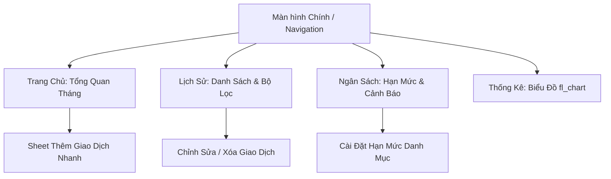
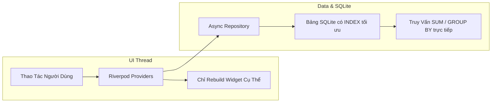
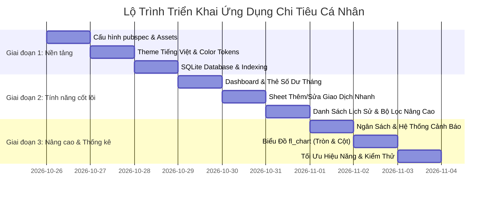

# Kế Hoạch Thiết Kế & Kiến Trúc Ứng Dụng Quản Lý Chi Tiêu Cá Nhân (Flutter)

---

## 1. Tôn Chỉ Sản Phẩm & Trải Nghiệm Người Dùng (Product Principles)

- **100% Tiếng Việt tự nhiên**: Mọi nhãn nút, tiêu đề, thông báo, đơn vị tiền tệ (`₫`, `VNĐ`) và ngày tháng (`Hôm nay`, `Hôm qua`, `Thứ Hai, 26/10`) đều sử dụng tiếng Việt thân thiện, không pha trộn tiếng Anh kỹ thuật.
- **Tốc độ nhập liệu thần tốc (UX < 3 giây)**: Người dùng có thể mở app -> bấm nút (+) -> nhập số tiền với phím tắt nhanh -> chọn danh mục -> bấm Lưu trong chưa đầy 3 giây.
- **Siêu mượt & Không giật lag (Zero-Jank, 60-120 FPS)**:
  - Tối ưu hóa triệt để cơ sở dữ liệu SQLite: đánh index thông minh, tính toán số dư và tổng hợp trực tiếp bằng lệnh SQL aggregate, không tính toán trong vòng lặp Dart.
  - Phân tách State hạt mịn (fine-grained) với Riverpod: chỉ render đúng widget cần cập nhật, không giật màn hình khi cuộn.
- **Hoạt động Ngoại tuyến Tuyệt đối (100% Offline-First)**: Lưu dữ liệu ngay trên thiết bị, không cần mạng, không lo mất dữ liệu, bảo mật tài chính cá nhân 100%.

---

## 2. Hệ Thống Nhận Diện UI, Màu Sắc & Bộ Icon Danh Mục

### 2.1. Bảng màu giao diện chính (Theme Palette)
- **Màu Số dư / Thương hiệu (Balance / Brand)**: `Indigo Blue` (`#4F46E5` / `#6366F1`) – Cảm giác vững vàng, tin cậy, hiện đại.
- **Màu Khoản Thu (Income)**: `Emerald Green` (`#10B981`) – Biểu thị tiền vào, dòng tiền dương, sự thịnh vượng.
- **Màu Khoản Chi (Expense)**: `Rose Coral` (`#F43F5E`) – Màu đỏ san hô sang trọng, phân biệt tức thì khoản tiền ra mà không gây cảm giác chói gắt.
- **Màu Cảnh báo Ngân sách**:
  - `< 70%`: `Xanh ngọc` (`#10B981`) - Chi tiêu trong vùng an toàn.
  - `70% - 90%`: `Hổ phách / Cam` (`#F59E0B`) - Cảnh báo tiệm cận hạn mức.
  - `> 90% hoặc vượt 100%`: `Đỏ rực` (`#EF4444`) - Cảnh báo bội chi nguy hiểm.
- **Chế độ hiển thị**:
  - **Chế độ Tối (Dark Mode)**: Nền Slate OLED (`#0F172A`), thẻ card bề mặt (`#1E293B`), chữ sáng rõ nét chống mỏi mắt.
  - **Chế độ Sáng (Light Mode)**: Nền mây sạch (`#F8FAFC`), thẻ card trắng tinh khôi (`#FFFFFF`), đổ bóng viền mờ tinh tế.

### 2.2. Bộ danh mục thu/chi mặc định chuẩn người Việt (Icon & Màu trực quan)

#### Danh mục Khoản Chi (Chi Tiêu Hàng Ngày)
| Icon | Tên danh mục | Màu sắc đại diện | Ý nghĩa / Ví dụ |
| :---: | :--- | :--- | :--- |
| 🍜 | **Ăn uống** | Cam đất (`#FB923C`) | Cơm, phở, cà phê, ăn ngoài, trà sữa |
| 🛵 | **Di chuyển** | Xanh Cyan (`#06B6D4`) | Xăng xe, gửi xe, Grab, bảo dưỡng xe |
| 🏠 | **Nhà cửa & Hóa đơn** | Tím mộng mơ (`#8B5CF6`) | Tiền thuê nhà, tiền điện, nước, internet |
| 🛍️ | **Mua sắm** | Hồng Pastel (`#EC4899`) | Quần áo, mỹ phẩm, đồ gia dụng, công nghệ |
| 🎬 | **Giải trí** | Vàng ấm (`#FBBF24`) | Xem phim, du lịch, họp mặt bạn bè, game |
| 💊 | **Sức khỏe & Y tế** | Xanh ngọc bích (`#14B8A6`) | Thuốc men, khám bệnh, phòng gym, bảo hiểm |
| 📚 | **Học tập & Tri thức** | Xanh dương (`#3B82F6`) | Sách, khóa học rèn luyện kỹ năng |
| 👨‍👩‍👧 | **Gia đình** | Tím sẫm (`#7C3AED`) | Gửi tiền bố mẹ, chi cho con cái |
| 📦 | **Khoản chi khác** | Xám trung tính (`#94A3B8`) | Các khoản lặt vặt khác |

#### Danh mục Khoản Thu (Thu Nhập)
| Icon | Tên danh mục | Màu sắc đại diện | Ý nghĩa / Ví dụ |
| :---: | :--- | :--- | :--- |
| 💼 | **Tiền lương** | Xanh lá tươi (`#10B981`) | Thu nhập cố định hàng tháng |
| 🎁 | **Thưởng & Lì xì** | Đỏ may mắn (`#EF4444`) | Tiền thưởng dự án, quà tặng, lì xì Tết |
| 📈 | **Đầu tư & Tiết kiệm** | Vàng kim (`#EAB308`) | Lãi ngân hàng, chứng khoán, cổ tức |
| 💡 | **Thu nhập phụ** | Tím dạ quang (`#A855F7`) | Làm thêm ngoài giờ, bán hàng online |
| 💰 | **Thu nhập khác** | Xanh lơ (`#0EA5E9`) | Các nguồn thu vãng lai khác |

*(Hỗ trợ tính năng người dùng tự tạo thêm danh mục tùy ý, chọn icon và đổi màu).*

---

## 3. Kiến Trúc Chi Tiết Các Màn Hình & Trải Nghiệm Người Dùng (UX Flow)



### 3.1. Màn hình 1: Trang Chủ (Tổng Quan / Dashboard)
1. **Thanh tiêu đề (Header)**:
   - Lời chào theo thời gian thực: *"Chào buổi sáng / Chào buổi chiều / Chào buổi tối"*.
   - **Bộ chọn tháng nhanh**: Hiển thị dạng `Tháng 10, 2026` ở giữa với 2 nút mũi tên trái (`<`) và phải (`>`) để chuyển tháng tức thì mà không cần mở lịch.
2. **Thẻ Tài Chính Trung Tâm (Hero Card - Bền vững & Đẹp mắt)**:
   - Hiển thị lớn: **Số dư tháng** = Tổng thu - Tổng chi (Font số đậm, định dạng `12.450.000 ₫`).
   - Phía dưới chia 2 cột rõ ràng:
     - Cột trái: **Tổng thu** kèm mũi tên xanh hướng lên (`▲ 20.000.000 ₫`).
     - Cột phải: **Tổng chi** kèm mũi tên đỏ hướng xuống (`▼ 7.550.000 ₫`).
3. **Thanh Ngân Sách Thu Nhỏ (Mini Budget Gauge)**:
   - Nếu có đặt ngân sách tháng: Hiện thanh tiến độ mỏng thanh lịch hiển thị `% ngân sách đã dùng` và số tiền còn lại được phép tiêu.
4. **Danh Sách "Giao dịch gần đây"**:
   - Nhóm tự động theo các mốc thời gian: **Hôm nay**, **Hôm qua**, hoặc ngày cụ thể.
   - Mỗi dòng giao dịch gồm: Icon danh mục bo tròn nền màu nhẹ, Tên danh mục, Ghi chú mờ phía dưới, Số tiền (Xanh lá `+` hoặc Đỏ `-`).
5. **Nút Thêm Giao Dịch Nhanh (FAB +)**:
   - Nút nổi tròn bo mềm nằm góc dưới phải, chạm vào lập tức trượt màn hình thêm giao dịch từ đáy lên (Bottom Sheet) với hiệu ứng Spring Animation mượt mà.

### 3.2. Màn hình 2: Thêm / Sửa Giao Dịch Nhanh (Quick Transaction Sheet)
*Mục tiêu UX: Nhập 1 tay nhanh nhất có thể.*
1. **Nút gạt loại giao dịch (Segmented Control)**:
   - Tab gạt to rõ giữa **[ Khoản chi ]** và **[ Khoản thu ]**, đổi màu tương ứng (Đỏ hoặc Xanh).
2. **Ô Nhập Số Tiền Cực Lớn**:
   - Chữ số to nổi bật giữa màn hình, tự động định dạng hàng nghìn khi gõ (ví dụ bấm `35000` -> hiện ngay `35.000 ₫`).
   - Hàng phím tắt cộng tiền nhanh: **`+10k`**, **`+50k`**, **`+100k`**, **`+500k`**, **`+1Tr`** giúp bấm 1 nút là tăng tiền mà không phải gõ số 0.
3. **Lưới Chọn Danh Mục 2 Hàng (Horizontal / Grid)**:
   - Các icon danh mục được vẽ to, có viền active nổi bật khi chọn. Danh mục hay dùng nhất xếp đầu tiên.
4. **Thời Gian & Ghi Chú**:
   - Ô chọn ngày: Mặc định là `Hôm nay (26/10)`. Nhấn vào mở lịch chọn ngày nếu muốn ghi bù cho hôm trước.
   - Ô ghi chú: Điền mô tả ngắn gọn (ví dụ: "Ăn bún chả trưa").
5. **Nút "Lưu Giao Dịch"**:
   - Nút dài tràn đáy màn hình, màu đậm, phản hồi xúc giác nhẹ (Haptic feedback nếu có), lưu xong tự động đóng và cập nhật số dư trong 0.1 giây.

### 3.3. Màn hình 3: Lịch Sử Giao Dịch & Bộ Lọc Nâng Cao
1. **Thanh Tìm Kiếm Nhanh**:
   - Gõ từ khóa để lọc ngay theo ghi chú hoặc tìm theo số tiền (ví dụ: gõ "cà phê" hoặc "50000").
2. **Bộ Lọc Nhanh Dạng Chip (Filter Chips)**:
   - Lọc theo loại: `Tất cả` | `Chỉ khoản chi` | `Chỉ khoản thu`.
   - Lọc theo thời gian: `Tháng này` | `Tháng trước` | `Hôm nay` | `Tùy chọn khoảng ngày`.
   - Lọc theo Danh mục: Chọn lọc riêng cho danh mục "Ăn uống" hay "Mua sắm".
3. **Thao Tác Danh Sách**:
   - Chạm vào dòng: Mở giao diện xem chi tiết hoặc chỉnh sửa.
   - Vuốt sang trái (Swipe-to-Dismiss): Hiện nút xóa màu đỏ. Khi bấm xóa có thông báo xác nhận: *"Bạn có chắc muốn xóa giao dịch này không?"* để không bị lỡ tay.

### 3.4. Màn hình 4: Ngân Sách & Cảnh Báo Bội Chi (Budgets & Alerts)
1. **Thiết Lập Ngân Sách**:
   - Ngân sách tổng cho toàn bộ chi tiêu trong tháng (ví dụ: Hạn mức chi tiêu tháng 10: `10.000.000 ₫`).
   - Ngân sách riêng cho từng danh mục trọng điểm (ví dụ: Ăn uống tối đa `4.000.000 ₫`, Mua sắm tối đa `1.500.000 ₫`).
2. **Thước Đo Tiến Độ & Cảnh Báo Trực Quan**:
   - Mỗi thẻ ngân sách hiển thị: Tên danh mục, Số tiền đã tiêu / Hạn mức, Số tiền còn lại.
   - Thanh tiến trình đổi màu 3 cấp độ:
     - 🟢 **An toàn (< 70%)**: Màu xanh lá - *"Bạn đang kiểm soát chi tiêu rất tốt"*.
     - 🟡 **Cảnh báo (70% - 90%)**: Màu cam hổ phách - *"Cảnh báo: Đã tiêu 82% ngân sách"*.
     - 🔴 **Báo động (> 90% hoặc quá 100%)**: Màu đỏ đậm - *"Nguy cơ bội chi! Đã vượt hạn mức 150.000 ₫"*.

### 3.5. Màn hình 5: Thống Kê & Phân Tích Biểu Đồ Cao Cấp (fl_chart: Đẹp, Trực Quan, Dễ Nhìn)

> [!TIP]
> **Tiêu chuẩn thiết kế Biểu đồ Đẹp & Dễ Nhìn:**
> Biểu đồ tài chính thường dễ bị rối mắt nếu quá nhiều màu hoặc số liệu chằng chịt. Ứng dụng áp dụng quy chuẩn thiết kế thông minh:
> - **Biểu đồ Donut rỗng tâm hiện đại**: Lát cắt có khe hở (section space) bo nhẹ, không bị dính chùm màu sắc.
> - **Tự động gom nhóm danh mục nhỏ**: Tự động gom các danh mục nhỏ (< 3%) vào mục "Khác" để biểu đồ luôn thoáng đãng, chỉ tập trung vào các khoản chi chủ lực.
> - **Chạm tương tác (Interactive Touch)**: Chạm vào lát cắt nào, lát cắt đó phóng to nhẹ và tâm biểu đồ lập tức cập nhật thông tin chi tiết.
> - **Thẻ Nhận Định Thông Minh (Insights Card)**: Đưa ra phân tích ngắn gọn, trực quan bằng tiếng Việt mà không cần người dùng phải tự suy luận số liệu.

1. **Thẻ Nhận Định Tài Chính Nhanh (Smart Insights)**:
   - Đặt ngay trên cùng màn hình thống kê:
     - 💡 *"Danh mục chi nhiều nhất: **Ăn uống** (chiếm **42%** tổng chi tiêu)"*.
     - 📈 *"Tỷ lệ tiết kiệm tháng này: **38%** (Đang tích lũy tốt 👍)"*.
     - 📉 *"Chi tiêu giảm **8.5%** so với tháng trước"*.

2. **Biểu Đồ Tròn Donut (Cơ Cấu Chi Tiêu Theo Danh Mục)**:
   - **Tâm biểu đồ**: Hiển thị tổng số tiền chi của tháng to rõ (`7.550.000 ₫`) kèm nhãn *"Tổng chi tháng"*.
   - **Hiệu ứng chạm phóng to (Active Selection)**:
     - Khi chạm vào một lát cắt (ví dụ: Ăn uống), lát cắt nở rộng từ 40px lên 50px, đổ bóng nhẹ.
     - Tâm biểu đồ lập tức chuyển sang hiển thị: `🍜 Ăn uống` - `3.200.000 ₫` (**42.4%**).
   - **Danh sách Chú giải (Legend Cards) dạng thẻ xếp hạng bên dưới**:
     - Xếp thứ tự từ khoản chi nhiều nhất đến ít nhất.
     - Mỗi thẻ hiển thị:
       - Huy hiệu Icon danh mục bo tròn với màu nền riêng biệt.
       - Tên danh mục (vd: "Ăn uống", "Nhà cửa & Hóa đơn").
       - Thanh đo tỷ lệ mini (mini progress bar) trực quan.
       - Số tiền chi và tỷ lệ phần trăm (vd: `3.200.000 ₫` • `42%`).

3. **Biểu Đồ Cột Đôi So Sánh Thu - Chi Qua Các Tháng (Monthly Comparison Bar Chart)**:
   - **Thiết kế cột bo góc mềm (Rounded Bar Caps)**: Đỉnh mỗi cột được bo góc 6px tinh tế, kết hợp dải màu Gradient nhẹ (Xanh ngọc cho Thu, Đỏ san hô cho Chi).
   - **Đường lưới phụ mờ (Subtle Gridlines)**: Đường đứt đoạn xám trong suốt, không gây rối mắt.
   - **Trục tọa độ tối ưu cho màn hình điện thoại**:
     - Trục X: Viết tắt ngắn gọn (`T5`, `T6`, `T7`, `T8`, `T9`, `T10`).
     - Trục Y: Rút gọn số tiền tự động (`5Tr`, `10Tr`, `15Tr`, `20Tr`) giúp không chiếm diện tích ngang của biểu đồ.
   - **Tooltip Nổi Trực Quan**: Khi chạm vào một tháng, hiển thị popup nổi bo góc mờ hiển thị chi tiết:
     - 🟢 Thu nhập: `+ 20.000.000 ₫`
     - 🔴 Chi tiêu: `- 12.500.000 ₫`
     - 💎 Dư ra (Tiết kiệm): `+ 7.500.000 ₫`

---

## 4. Chiến Lược Tối Ưu Hiệu Năng & SQLite Chống Đơ / Giật Lag



### 4.1. Tối ưu tầng SQLite (Database Layer)
- **Thiết kế Index tối ưu**:
  ```sql
  CREATE INDEX idx_transactions_date ON transactions(date);
  CREATE INDEX idx_transactions_category ON transactions(category_id);
  CREATE INDEX idx_transactions_type_date ON transactions(type, date);
  ```
  Nhờ các index này, câu lệnh tìm kiếm theo tháng hoặc tính tổng tiền chỉ quét qua index trong B-Tree, thời gian thực thi `< 2 mili-giây`.
- **Tổng hợp trực tiếp bằng SQL (Aggregations in Engine)**:
  - Thay vì nạp 2.000 giao dịch vào bộ nhớ điện thoại rồi dùng vòng lặp `.fold()` hay `.reduce()` trong Dart, ta dùng:
    ```sql
    SELECT type, SUM(amount) as total FROM transactions 
    WHERE date >= ? AND date <= ? 
    GROUP BY type;
    ```
    SQLite tính toán ở tầng C cực nhanh và chỉ trả về 2 con số cho Flutter hiển thị.
- **SQLite Batching**: Khởi tạo danh mục ban đầu hoặc khôi phục dữ liệu chạy trong 1 `db.batch()` duy nhất, giảm 95% thời gian ghi đĩa.

### 4.2. Tối ưu tầng Giao Diện & Bộ Nhớ (Rendering & Dart Layer)
- **Sử dụng `const` triệt để**: Toàn bộ icon, padding, text style cố định đều dùng `const` để Flutter tái sử dụng widget tree, không cấp phát rác bộ nhớ (Zero Garbage Collection pressure).
- **Bộ format tĩnh (Static Formatters)**:
  - Giữ cố định instance `NumberFormat.currency(locale: 'vi_VN', symbol: '₫')` và `DateFormat('dd/MM/yyyy')`, tránh tạo mới liên tục trong hàm `build()`.
- **Ảo hóa danh sách (List Virtualization)**:
  - Sử dụng `ListView.builder` kết hợp `itemExtent` hoặc `SliverList` để chỉ render các phần tử đang hiển thị trên màn hình, giải phóng phần tử ngoài tầm nhìn.
- **Debounce cho ô tìm kiếm**: Trì hoãn 300ms sau khi người dùng ngừng gõ mới truy vấn database, loại bỏ hoàn toàn hiện tượng khựng bàn phím.

---

## 5. Schema Cơ Sở Dữ Liệu SQLite Chi Tiết

### Bảng `categories` (Danh mục)
| Tên cột | Kiểu dữ liệu | Ràng buộc | Mô tả |
| :--- | :--- | :--- | :--- |
| `id` | `TEXT` | `PRIMARY KEY` | Khóa chính dạng UUID |
| `name` | `TEXT` | `NOT NULL` | Tên danh mục tiếng Việt (vd: "Ăn uống") |
| `type` | `TEXT` | `NOT NULL` | `'EXPENSE'` hoặc `'INCOME'` |
| `icon_code` | `TEXT` | `NOT NULL` | Mã định danh icon (vd: `'fastfood'`, `'motorcycle'`) |
| `color_hex` | `TEXT` | `NOT NULL` | Mã màu hex (vd: `'#FB923C'`) |
| `is_default` | `INTEGER` | `NOT NULL DEFAULT 0` | 1 nếu là danh mục mặc định của hệ thống |

### Bảng `transactions` (Khoản thu / chi)
| Tên cột | Kiểu dữ liệu | Ràng buộc | Mô tả |
| :--- | :--- | :--- | :--- |
| `id` | `TEXT` | `PRIMARY KEY` | Khóa chính UUID |
| `amount` | `REAL` | `NOT NULL` | Số tiền (luôn dương) |
| `type` | `TEXT` | `NOT NULL` | `'EXPENSE'` hoặc `'INCOME'` |
| `category_id` | `TEXT` | `NOT NULL` | Khóa ngoại liên kết tới bảng `categories` |
| `date` | `TEXT` | `NOT NULL` | Ngày giờ dạng chuỗi ISO (`YYYY-MM-DDTHH:mm:ss`) |
| `note` | `TEXT` | `NULLABLE` | Ghi chú thêm |
| `created_at` | `TEXT` | `NOT NULL` | Thời điểm tạo bản ghi |

### Bảng `budgets` (Hạn mức ngân sách)
| Tên cột | Kiểu dữ liệu | Ràng buộc | Mô tả |
| :--- | :--- | :--- | :--- |
| `id` | `TEXT` | `PRIMARY KEY` | Khóa chính UUID |
| `category_id` | `TEXT` | `NULLABLE` | Khóa ngoại danh mục (NULL nếu là ngân sách tổng tháng) |
| `month_key` | `TEXT` | `NOT NULL` | Tháng áp dụng dạng `'YYYY-MM'` (vd: `'2026-10'`) |
| `limit_amount` | `REAL` | `NOT NULL` | Hạn mức chi tiêu tối đa |

---

## 6. Lộ Trình Triển Khai Chi Tiết (Execution Roadmap)



- **Giai đoạn 1**: Cấu hình dependencies, Theme tiếng Việt chuẩn Material 3, Khởi tạo SQLite Engine có Index và dữ liệu danh mục ban đầu.
- **Giai đoạn 2**: Xây dựng Trang chủ Dashboard (Thẻ số dư tháng, tổng thu, tổng chi), Form nhập liệu giao dịch siêu nhanh và Màn hình Lịch sử có bộ lọc linh hoạt.
- **Giai đoạn 3**: Triển khai Ngân sách & Cảnh báo hạn mức, Xây dựng 2 biểu đồ phân tích trực quan với `fl_chart`, Kiểm thử toàn diện và tối ưu hóa 60-120 FPS.

---

## 7. Kế Hoạch Xác Minh & Kiểm Thử (Verification Plan)

### Kiểm thử tính năng (Feature Verification)
1. **Kiểm tra tính bền vững của SQLite**:
   - Thêm 3 giao dịch (1 thu, 2 chi) -> Đóng hoàn toàn app -> Mở lại app -> Kiểm tra các bản ghi và số dư vẫn hiển thị chuẩn xác 100%.
2. **Kiểm tra tính toán số dư**:
   - Lương +15.000.000 ₫, Ăn uống -2.000.000 ₫, Tiền nhà -3.500.000 ₫ -> Số dư hiển thị chính xác `9.500.000 ₫`.
3. **Kiểm tra cảnh báo ngân sách**:
   - Đặt ngân sách Ăn uống `1.000.000 ₫`. Chi tiêu đến `850.000 ₫` (85%) -> Thanh tiến độ chuyển sang màu vàng cảnh báo. Chi thêm `200.000 ₫` (thành 105%) -> Thanh chuyển sang màu đỏ và hiện nhãn vượt hạn mức.
4. **Kiểm tra biểu đồ**:
   - Xác nhận biểu đồ tròn phân chia lát cắt đúng tỷ lệ phần trăm và biểu đồ cột hiển thị đúng thu vs chi của các tháng.

### Kiểm thử hiệu năng (Performance Verification)
1. Thử nghiệm nạp 1.000 bản ghi mẫu vào SQLite -> Đo thời gian mở app và tải Dashboard (yêu cầu dưới 300ms).
2. Cuộn danh sách liên tục kiểm tra tốc độ khung hình (yêu cầu mượt mà không khựng giật).
